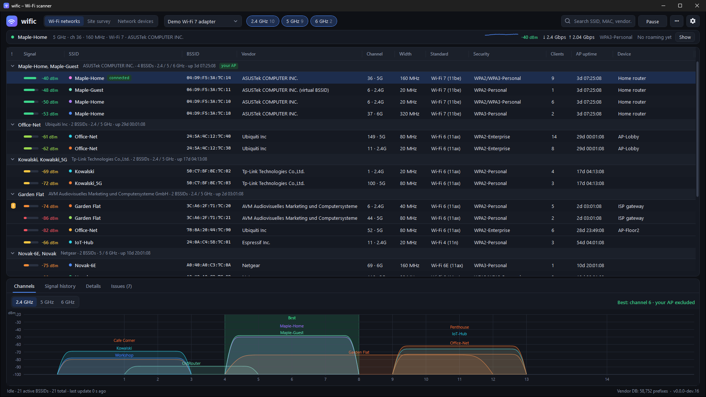
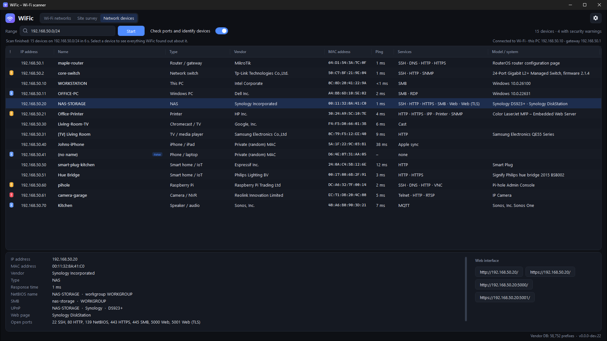
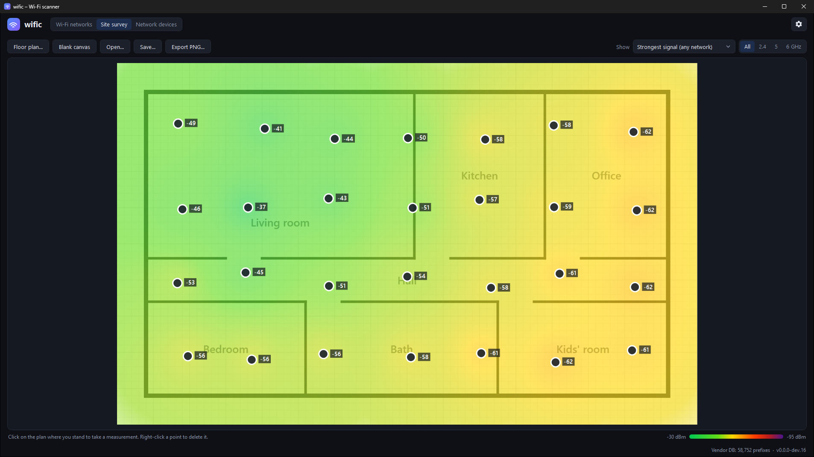
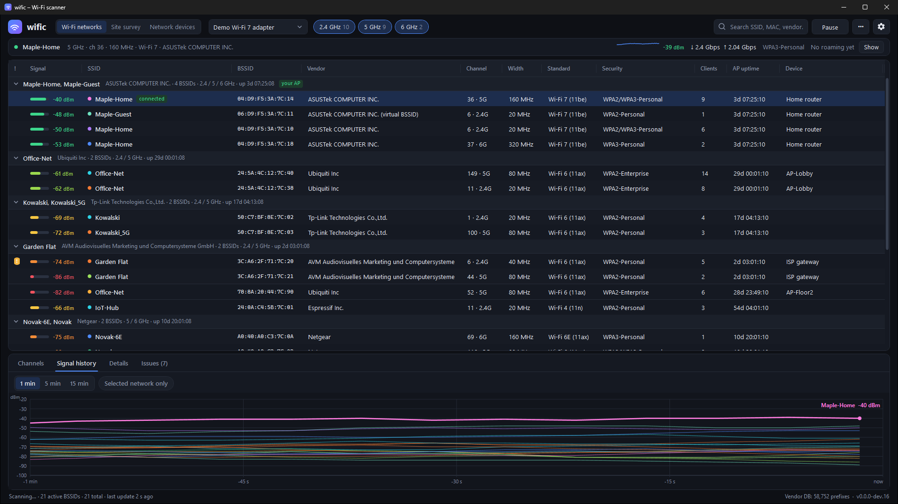
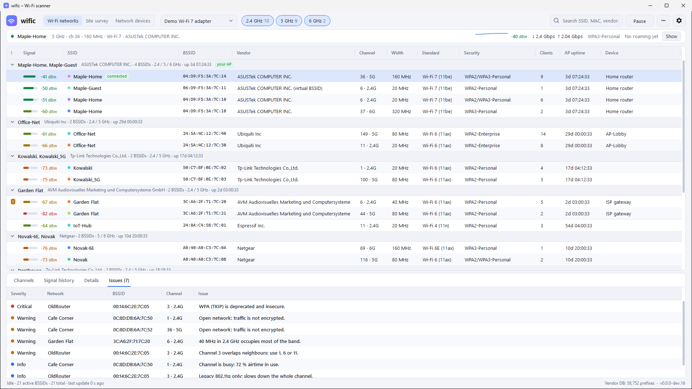

<p align="center">
  
</p>

<h1 align="center">wific</h1>

<p align="center">
  Free, portable Wi-Fi network scanner for Windows: 2.4 GHz, 5 GHz and 6 GHz.<br>
  <a href="https://github.com/trelowney/wific/releases/latest"><b>Download the latest release</b></a>
</p>

<p align="center">
  
</p>

---

wific shows every access point (BSSID) around you and decodes its beacon to show the details that usually need a
paid tool: real channel width, AP uptime, vendor, Wi-Fi generation, security, client count and channel load.
It also finds the devices on your network (an IP scanner) and draws coverage heatmaps on a floor plan.

## Features

- **All bands**: 2.4 GHz, 5 GHz and 6 GHz (Wi-Fi 6E / Wi-Fi 7). 6 GHz needs a Wi-Fi 6E or 7 adapter.
- **Channel width**: 20 / 40 / 80 / 160 / 320 MHz and 80+80, decoded from the HT, VHT, HE (incl. 6 GHz) and EHT operation elements.
- **AP uptime**: derived from the beacon TSF timer, which counts from when the radio started.
- **Vendor lookup**: built-in IEEE registry (MA-L, MA-M and MA-S, about 58,000 prefixes). Locally administered or virtual
  BSSIDs are resolved through the base MAC address. WPS manufacturer/model and Cisco AP names are shown when the AP broadcasts them.
- **Standard and speed**: Wi-Fi 4/5/6/6E/7, spatial streams and theoretical maximum PHY rate.
- **Security**: WPA/WPA2/WPA3 Personal and Enterprise, OWE, WEP, ciphers and PMF (802.11w).
- **Load**: number of associated clients and channel utilization (BSS Load element).
- **Extras**: country code, BSS color, beacon interval, 802.11k/v/r roaming support, Wi-Fi 7 multi-link, raw information elements.
- **Physical access points**: BSSIDs that belong to the same device (several SSIDs and bands) are grouped together.
  Grouping uses MAC address similarity and the radios' boot time.
- **Best channel**: for each band, the least congested channel, computed from the signal strength and load of overlapping
  networks. Your own AP is ignored, because it is the one you would move.
- **Your connection**: live signal sparkline, link rate, security and roaming history in one compact strip.
- **Issues**: flags WEP/WPA/TKIP, open networks, overlapping 2.4 GHz channels, 40 MHz in 2.4 GHz, busy channels,
  legacy-only APs and possible evil twins. Issues appear as a small badge in the table and as a list in the Issues tab.
- **Graphs**: a channel/spectrum view for each band and a signal history of 1, 5 or 15 minutes.
- **Filters**: band, search (SSID / BSSID / vendor / device), hide inactive, hide hidden networks.
- **Your layout**: columns spread over the window so nothing is cut off. Right-click the table header to choose columns;
  column order, window size and panel height are remembered.
- **Dark and light theme**, or follow the Windows setting.
- **Network devices** (IP scanner): finds every device on the network you are connected to, or on any range you enter
  (192.168.1.0/24, 10.0.0.1-50, single addresses). For each device it shows the IP and MAC address, vendor, response time and
  open common ports, and works out what the device is: its name (DNS, NetBIOS, mDNS, SMB, UPnP), model or Windows version, and a
  type such as router, printer, NAS, camera, TV or phone. Web interfaces open with one click, and risky services
  (Telnet, FTP, VNC) are flagged. Port checks can be turned off for a quick ping-only scan.
- **Site survey heatmap**: load a floor plan (or use a blank canvas) and click where you are standing. wific measures
  for about 4 seconds and draws a coverage heatmap for any network and band. Surveys can be saved and exported as PNG.
- **Recording and playback**: record a session to a `.wificrec` file and replay it later with a timeline, for example
  to compare coverage before and after moving a router.
- **CSV export**.
- **Portable**: a single `.exe` with no installer and no registry entries. Settings are saved in `wific.settings.json` next to the exe.
- **Built-in updater**: wific tells you when a new release is out and can replace itself in one click.

## Screenshots

<table>
  <tr>
    <td><br><sub>Network devices: names, types, models and open services</sub></td>
    <td><br><sub>Site survey: coverage heatmap on a floor plan</sub></td>
  </tr>
  <tr>
    <td><br><sub>Signal history of all networks</sub></td>
    <td><br><sub>Light theme, security issues</sub></td>
  </tr>
</table>

The screenshots use made-up networks and devices.

## Requirements

- Windows 10 or Windows 11 (x64 or ARM64)
- A Wi-Fi adapter. 6 GHz scanning needs a Wi-Fi 6E / 7 adapter with a current driver.
- **Windows 11 24H2 and later:** Windows only gives scan results to desktop apps when **Location services** are on.
  Go to *Settings → Privacy & security → Location* and turn on both *Location services* and *Let desktop apps access your location*.
  wific shows a button that opens that page when access is blocked. wific never reads or stores your location.

## Download

Get `wific-win-x64.exe` (or `wific-win-arm64.exe`) from
[Releases](https://github.com/trelowney/wific/releases/latest) and run it. No installation is needed.

## How it works

wific uses the Windows Native Wifi API (`wlanapi.dll`). It requests a scan (`WlanScan`), reads the BSS list
(`WlanGetNetworkBssList`) and parses the 802.11 information elements of each beacon or probe response itself.
No administrator rights, drivers or monitor mode are needed.

## Building

Releases are built only by [GitHub Actions](.github/workflows/build.yml) with .NET 10. The build treats every warning as
an error, so a release is only published from a build with no warnings. To publish a release, push a tag such as `v0.2.0`.

To build locally (optional):

```
dotnet publish src/Wific/Wific.csproj -c Release -r win-x64 --self-contained -p:PublishSingleFile=true
```

## License

Copyright © 2026 trelowney

wific is free software, licensed under the **GNU General Public License v3.0 or later** ([LICENSE](LICENSE)).
You may use, study, share and modify it. If you distribute wific or a modified version, you must keep the copyright
notice and credit this project, and you must release your source code under the same license.

The MAC vendor data comes from the IEEE registration authority, via the Wireshark `manuf` file.
